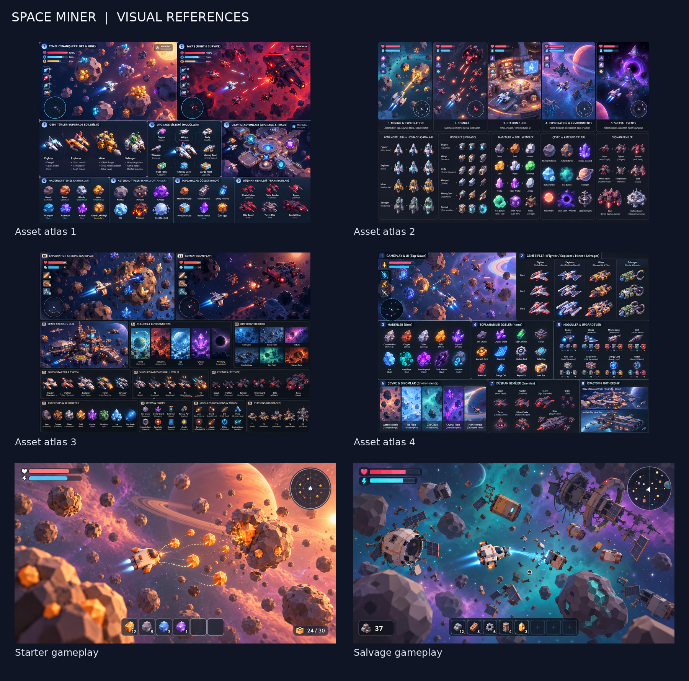

# Project Space

> Çalışma adı: **Project Space / Space Miner** · Godot 4.7 · Forward+ · GDScript



**TR —** Sevimli, sıcak ve sakin bir **2.5D top-down low-poly uzay oyunu**. Kendi küçük gemini sür; asteroidlerden **Laser / Bomb / Drill** ile maden çıkar, enkazlardan parça sök, ganimet topla, gerektiğinde korsanlarla çatış ve gemini parça parça (Head / Engine / Wings / Body) geliştir. Sınıf kilidi yok, her ekipman her evrensel hardpoint'e takılabilir; bedeli kütle, enerji, ısı ve yakıttan ödenir. Uzun vadede kendi **Mother Ship**'ine sahip ol.

**EN —** A cute, cozy, chill **2.5D top-down low-poly space game**. Fly your little ship, mine asteroids with a **Laser, Bomb or Drill**, salvage wrecks, grab loot, dogfight the odd pirate and upgrade your ship piece by piece (Head / Engine / Wings / Body). No class locks: any active module fits any universal hardpoint, balanced by mass, energy, heat and fuel. Long term: own and grow your own **Mother Ship**.

## Durum / Status

Ön üretim. Hedef: **M1 Vertical Slice** — tek starter gemi, top-down kamera, asteroid alanı, laser madenciliği, loot toplama, temel HUD, bir düşman drone ve post-process/VFX geçişi. Bkz. [docs/ROADMAP.md](docs/ROADMAP.md).

## Başlangıç / Getting started

```bash
git lfs install
git clone https://github.com/Asreonn/project-space.git
cd project-space
godot -e --path .        # Godot 4.7.x stable
```

## Belgeler / Docs

| Dosya | İçerik |
|---|---|
| [docs/GAME_PLAN.md](docs/GAME_PLAN.md) | Ana tasarım belgesi (bağlayıcı) |
| [docs/DECISIONS.md](docs/DECISIONS.md) | GAME_PLAN sonrası alınan kararlar (ör. motor = Godot 4) |
| [docs/ROADMAP.md](docs/ROADMAP.md) | Milestone'lar |
| [docs/briefs/](docs/briefs/) | Rol brief'leri (design, gameplay, modeling, ui, vfx, engineering) |
| [docs/TOOLS.md](docs/TOOLS.md) | Araç zinciri, MCP sunucuları, açık kaynak VFX/asset kaynakları |
| [docs/references/](docs/references/) | Görsel referanslar + el yazısı tasarım notu (PDF) |
| [AGENTS.md](AGENTS.md) | Ekip kuralları: sahiplik, branch/PR, isimlendirme, commit |

## Lisans / License

Kod: [MIT](LICENSE). `docs/references/` altındaki görseller tasarım referansıdır; oyun içinde asset olarak kullanılmaz. Üçüncü parti asset'ler [CREDITS.md](CREDITS.md)'de listelenir.
